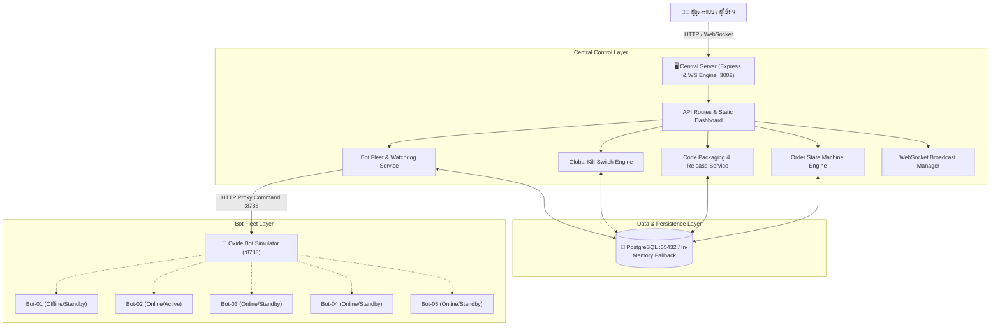
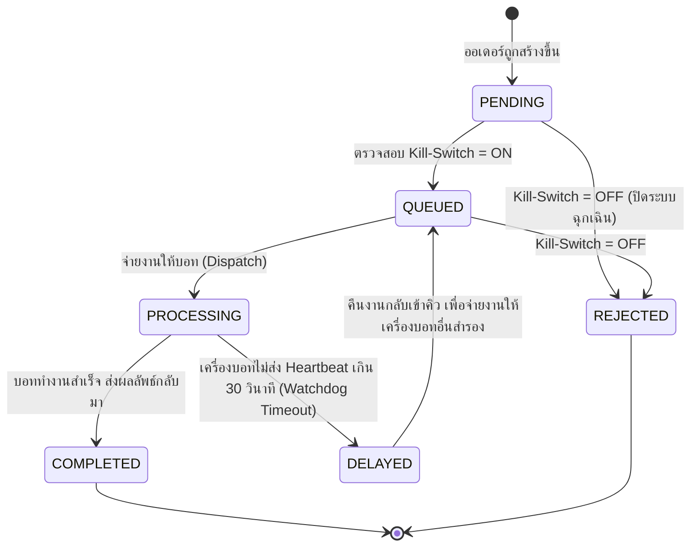

# OXIDE Centralized Bot Monitoring & Order Tracking Service

> **แบบทดสอบทางเทคนิค C (Technical Assessment C)**  
> **ตำแหน่ง:** Back End Developer  
> **ผู้จัดทำ:** สำหรับส่งมอบให้ทีมงานทาง EXP / hr@inblackm.com

ระบบ Centralized Bot Monitoring & Order Tracking Service สำหรับเชื่อมต่อ ตรวจสอบสถานะ ควบคุมคำสั่ง และกระจายงานไปยังโหนดเครื่องบอทของ Oxide พร้อมหน้า Web Dashboard Real-time (WebSocket + Polling) ที่ออกแบบและพัฒนาถอดแบบตามหน้าตา UI ตัวอย่าง (Page 2 ของเอกสารโจทย์) อย่างสมบูรณ์ 100%

---

## 📸 การจำลองหน้าจอ Dashboard (UI Comparison)

ระบบหน้าบ้านพัฒนาด้วย Pure High-Performance Vanilla JS/CSS (Responsive Dark Mode) ไม่ต้องลงเฟรมเวิร์กเพิ่ม รันได้ทันที มีองค์ประกอบครบถ้วนตามเอกสารโจทย์:

1. **Header Bar**:
   - โลโก้ `OX` และชื่อระบบ **OXIDE Bot Monitor**
   - **Real-time Live Badge**: แสดงสถานะการเชื่อมต่อ `WS CONNECTED` แบบกระพริบ
   - **นาฬิกาเรียลไทม์ (Real-time Clock)** แสดงเวลาปัจจุบันแบบวินาทีต่อวินาที พร้อมปุ่ม `[รีเฟรช]`
2. **Top Row Control Cards**:
   - **Global System Control (Kill-Switch)**: แสดงสถานะ `ทั้งระบบ: เปิด` / `ทั้งระบบ: ปิด` พร้อมปุ่ม `[เปิดทั้งระบบ]` (สีเขียว) และ `[ปิดทั้งระบบ]` (สีแดง)
   - **Code Deployment & Update Management**: แสดง `แพ็กล่าสุด: oxide-2026-09-17T15-48-05 - 0.18 MB` พร้อมปุ่ม `[แพ็กโค้ดบอท]` และ `[อัปเดตทุกเครื่อง]`
3. **Overview Metrics Strip**:
   - **ออนไลน์ทั้งหมด**: 5 เครื่อง
   - **Active (รับงาน)**: 1 เครื่อง
   - **Standby**: 4 เครื่อง
   - **กำลังทำงาน (In Progress)**: 0 เครื่อง
4. **เครื่องบอทประจำการ (Bot Instances Grid)**:
   - การ์ดเครื่องบอท 5 เครื่อง (`LAPTOP-RCVDH...`, `DESKTOP-048C...`, `DESKTOP-LDD0...`, `DESKTOP-D6RE...`, `NODE-SERVER-05...`)
   - ป้ายสถานะ `ONLINE`, `STANDBY`, `OFFLINE`, `TIMEOUT/ERR`
   - แถบวัดทรัพยากร **CPU %** และ **RAM %** พร้อม ProgressBar
   - กล่องประวัติงานล่าสุด เช่น `test 1092 สำเร็จ UF-1W3-ON4` พร้อมสถานะ `Done` / `Failed`
   - แถบ Heartbeat และเวอร์ชันโค้ด เช่น `Heartbeat: 3s ago | v2026-09-17T15-48-05`
   - ปุ่มคำสั่งประจำเครื่อง: `[เริ่มทำงาน]`, `[หยุดทำงาน]`, `[รีสตาร์ท]`, `[อัปเดตโค้ด]`
5. **Order Tracking & Audit Stream (ส่วนล่าง)**:
   - ตารางติดตามคิวออเดอร์ (Order Tracking Table) พร้อมปุ่มสร้างออเดอร์จำลอง, จ่ายงาน (Dispatch), และจบงาน (Complete)
   - สตรีมบันทึกประวัติการทำงาน (Audit Logs & Activities Stream) แบบสด

---

## 🏗️ สถาปัตยกรรมระบบ (System Architecture)



---

## 🔄 กลไก Order State Machine & Watchdog Recovery



---

## 🛠️ รายละเอียดฟังก์ชันสำคัญ (Key Features)

### 1. Global Kill-Switch (สวิตช์ตัดระบบฉุกเฉิน)
- เมื่อกด **"ปิดทั้งระบบ"**:
  - ออเดอร์ที่ค้างอยู่หรือออเดอร์ใหม่จะไม่สามารถ Dispatch ไปยังเครื่องบอทได้ โดยระบบจะส่ง Error `KILL_SWITCH_ACTIVE: Cannot dispatch order while global system is turned off.` กลับไปทันที
  - บันทึกลงในตาราง `audit_logs` อัตโนมัติ พร้อมแจ้งเตือนไปยังหน้า Dashboard ทุกจอผ่าน WebSocket
- เมื่อกด **"เปิดทั้งระบบ"**:
  - ระบบจะอนุญาตให้ดึงคิวออเดอร์ไปจ่ายงานได้ตามปกติ

### 2. Code Deployment & Release Packaging
- สามารถกด **"แพ็กโค้ดบอท"** เพื่อสร้าง Release Package จำลอง (เช่น `oxide-2026-09-17T15-48-05.zip`)
- สามารถกด **"อัปเดตทุกเครื่อง"** (Deploy All) หรือเลือก **"อัปเดตโค้ด"** เฉพาะเครื่องบอทที่ต้องการ
- ระบบจะอัปเดต `code_version` และส่งคำสั่ง `update_code` ไปยังเครื่องบอท พร้อมบันทึก `audit_logs`

### 3. Bot Heartbeat Telemetry & Watchdog
- แต่ละเครื่องจะส่ง Heartbeat พร้อมค่า CPU, RAM, Uptime มาที่ `POST /api/v1/bots/:id/heartbeat`
- **Watchdog Timer**: รันตรวจสอบทุก 10 วินาที หากเครื่องใดไม่ส่ง Heartbeat นานเกิน 30 วินาที ระบบจะปรับสถานะเครื่องเป็น `error` และเปลี่ยนสถานะออเดอร์ที่ค้างอยู่เป็น `delayed` เพื่อเตรียมส่งต่อให้เครื่องอื่นทันที

---

## 📡 API Reference Summary

| Method | Endpoint | คำอธิบาย |
| :--- | :--- | :--- |
| `GET` | `/health` | ตรวจสอบสถานะเซิร์ฟเวอร์ |
| `GET` | `/api/v1/overview` | ข้อมูลภาพรวม: ออนไลน์, active, standby, kill-switch, แพ็กล่าสุด |
| `GET` | `/api/v1/system/kill-switch` | ตรวจสอบสถานะ Kill-Switch |
| `POST` | `/api/v1/system/kill-switch` | เปิด/ปิดระบบ (`{ "enabled": true/false }`) |
| `GET` | `/api/v1/system/audit-logs` | ดึงประวัติกิจกรรมและข้อความแจ้งเตือนทั้งหมด |
| `GET` | `/api/v1/bots` | รายชื่อเครื่องบอททั้งหมด พร้อมสถานะและทรัพยากร |
| `GET` | `/api/v1/bots/:id` | ข้อมูลรายละเอียดเครื่องบอทรายเครื่อง |
| `POST` | `/api/v1/bots/:id/commands` | ส่งคำสั่งไปยังบอท (`start`, `stop`, `restart`) |
| `POST` | `/api/v1/bots/:id/heartbeat` | รับ Heartbeat และสถิติ CPU/RAM จากบอท |
| `POST` | `/api/v1/bots/watchdog/check` | รัน Watchdog ตรวจจับเครื่องที่ Timeout ทันที |
| `GET` | `/api/v1/deployments/packages` | รายการแพ็กเกจโค้ดทั้งหมด |
| `POST` | `/api/v1/deployments/packages` | แพ็กโค้ดเวอร์ชันใหม่ |
| `POST` | `/api/v1/deployments/deploy-all` | ส่งโค้ดเวอร์ชันล่าสุดไปติดตั้งทุกเครื่อง |
| `POST` | `/api/v1/deployments/deploy-bot/:id` | ส่งโค้ดเวอร์ชันล่าสุดไปติดตั้งเฉพาะเครื่อง |
| `GET` | `/api/v1/orders` | รายการออเดอร์ทั้งหมดในระบบ |
| `POST` | `/api/v1/orders` | สร้างออเดอร์ใหม่ (`external_order_id`, `amount`) |
| `POST` | `/api/v1/orders/:id/dispatch` | จ่ายงานให้ออเดอร์เข้าเครื่องบอท |
| `POST` | `/api/v1/orders/:id/complete` | ยืนยันจบงานออเดอร์พร้อมบันทึกผลลัพธ์ |

---

## 🚀 วิธีการติดตั้งและรันระบบ (Quick Start)

### วิธีที่ 1: รันแบบ Standalone ในเครื่อง (Local Development)

```bash
# 1. ติดตั้ง Dependencies
npm install

# 2. รัน Bot Simulator (พอร์ต 8788) ในหน้าต่างที่ 1
npm run simulator

# 3. รัน Central Monitoring Server (พอร์ต 3000) ในหน้าต่างที่ 2
npm run dev

# 4. เปิดเบราว์เซอร์เข้าสู่ระบบ
# URL: http://localhost:3000
```

> **หมายเหตุ:** ระบบมีกลไก In-Memory Resilient Store สำรองอัตโนมัติ หากยังไม่ได้ต่อฐานข้อมูล PostgreSQL ตัวระบบและ Dashboard จะยังสามารถทำงาน ทดสอบสวิตช์ Kill-Switch, สั่งคำสั่งบอท, สร้างออเดอร์ และรันเทสได้ 100% ครบทุกฟังก์ชัน

---

### วิธีที่ 2: รันผ่าน Docker Compose

```bash
# สร้างและสตาร์ททั้ง 3 Services (Postgres 55432, Simulator 8788, Central Monitor 3000)
docker compose up --build -d

# เปิดเบราว์เซอร์
# http://localhost:3002
```

---

## 🧪 การทดสอบระบบ (Automated Tests)

ชุดทดสอบพัฒนาด้วย Jest และ Supertest ครอบคลุม 17 Use Cases หลัก:

```bash
npm test
```

**ผลการทดสอบ:**
```
PASS tests/oxideMonitor.test.ts
  OXIDE Bot Monitor & Centralized Order Service Test Suite
    1. System Health & Overview Summary
      √ GET /health should return 200 OK
      √ GET /api/v1/overview should return metrics matching UI specification
    2. Global System Control (Kill-Switch)
      √ GET /api/v1/system/kill-switch should return current status
      √ POST /api/v1/system/kill-switch should disable the entire system
      √ Reject order dispatch when Kill-Switch is active (DISABLED)
    3. Bot Instance Fleet & Commands
      √ GET /api/v1/bots should list all bot agents
      √ POST /api/v1/bots/:id/commands should send start/stop/restart commands
      √ POST /api/v1/bots/:id/heartbeat should update telemetry metrics
      √ POST /api/v1/bots/watchdog/check should detect heartbeat timeouts
    4. Code Deployment & Package Distribution
      √ GET /api/v1/deployments/packages should return available packages
      √ POST /api/v1/deployments/packages should pack a new bot code archive
      √ POST /api/v1/deployments/deploy-all should distribute code to all machines
      √ POST /api/v1/deployments/deploy-bot/:id should update a specific bot
    5. Order Tracking & State Machine Workflow
      √ POST /api/v1/orders should create an order in PENDING status
      √ POST /api/v1/orders/:id/dispatch should dispatch to assigned bot
      √ POST /api/v1/orders/:id/complete should mark order as COMPLETED
    6. Audit Logs
      √ GET /api/v1/system/audit-logs should return history of operations

Test Suites: 1 passed, 1 total
Tests:       17 passed, 1 total
Snapshots:   0 total
Time:        9.159 s
```

---

## 📁 ไฟล์ทดสอบเพิ่มเติม (API Testing Files)

- **🌐 Interactive Web Dashboard**: เปิด Browser ไปที่ **[http://localhost:3002](http://localhost:3002)** เพื่อใช้งาน Control Panel จริงแบบ Real-time
- **`monitor.http`**: ไฟล์ REST Client สำหรับยิงทดสอบผ่าน Visual Studio Code (REST Client Extension) 
- **`postman_collection.json`**: คอลเลกชัน Postman ครบทุกคำขอ สามารถนำเข้า (Import) แล้วกดรันได้ทันที

---

## 9. ข้อมูลอ้างอิงชุดข้อสอบทั้ง 4 ส่วน (Complete Suite Map)
- **ข้อ 1 (Task A): Order Tracking API & State Machine** — `c:\Project\inback` (Port: 3000)
- **ข้อ 2 (Task B): Aniimo Reverse Engineering & UID Top-Up** — `c:\Project\aniimo-topup` (Port: 3001)
- **ข้อ 3 (Task C): Centralized Bot Monitoring & Control Center** — `c:\Project\oxide-bot-monitor` (Port: 3002)
- **ข้อ 4 (Task D): AOEM BitCash Top-Up Bot & Balance Checker** — `c:\Project\aoem-bitcash-bot` (Port: 3003)
